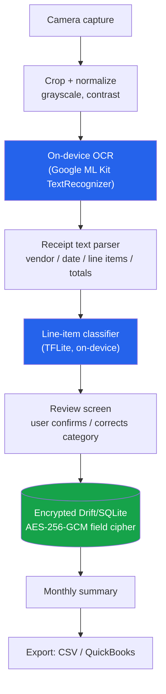

# ReceiptLens

**On-device receipt digitization for freelancers and small businesses — no cloud OCR, no uploaded financial documents, ever.**


## The problem

Freelancers and small businesses burn hours every month manually re-typing receipts into a spreadsheet or bookkeeping tool. The obvious fix — snap a photo, run it through a cloud OCR API — creates a new problem: it means uploading photos of invoices, credit card slips, and vendor names to a third-party server. For anyone bound by client confidentiality, HIPAA-adjacent work, or basic financial-privacy hygiene, that trade is a non-starter, so they're stuck doing it by hand.

ReceiptLens resolves that trade-off instead of asking the user to accept it: the camera capture, OCR, and expense-category classification all run **entirely on-device**. Nothing about the receipt — not the image, not the recognized text, not the parsed line items — ever leaves the phone. The only network traffic the app could possibly generate is the OS-level share sheet the user explicitly invokes to export a CSV, and that's opt-in, at export time, per file.

## How it works



Every box in the diagram above runs locally. The two ML-shaped steps — OCR and categorization — are each defined behind a small Dart interface (`TextRecognizer`, `LineItemClassifier`) with exactly one production implementation and one that's swappable for tests:

| Concern | Interface | Production implementation | Test double |
|---|---|---|---|
| Text recognition | `TextRecognizer` | `MlKitTextRecognizer` (`google_mlkit_text_recognition`, on-device) | `FakeTextRecognizer` (canned lines) |
| Categorization | `LineItemClassifier` | `TfliteLineItemClassifier` (`tflite_flutter`, on-device) | `DartReferenceClassifier` — a pure-Dart re-implementation of the *same trained weights*, used both as a unit-testable reference and as an automatic runtime fallback if the native TFLite interpreter can't initialize |

Because `DartReferenceClassifier` and `TfliteLineItemClassifier` share one exported weights file (`assets/model/weights.json`, trained by `tool/ml/train_classifier.py`), the unit test suite exercises the *actual trained model*, not a mock of it — with zero device, zero network, and zero native binaries required.

Storage follows the same "nothing leaves the device" principle one layer down: every sensitive text field (vendor name, raw OCR text, line-item description) is encrypted with AES-256-GCM before it touches SQLite via Drift, using a key that lives in the OS keychain (`flutter_secure_storage`) and never crosses a network boundary either.

## Quick start

Requires Flutter 3.35+ / Dart 3.9+ (developed against Flutter 3.44 / Dart 3.12).

```bash
# 1. Install dependencies
flutter pub get

# 2. Generate the Drift database code (checked in already, but regenerate
#    after touching lib/data/db/app_database.dart)
dart run build_runner build --delete-conflicting-outputs

# 3. Static analysis
flutter analyze

# 4. Run the full offline test suite (unit + widget, no device required)
flutter test

# 5. Run on a connected device/simulator
flutter run
```

### Retraining the classifier (optional)

The bundled model is a tiny bag-of-words → dense(relu) → dense(softmax) network trained on `tool/ml/training_data.csv`. It's fully reproducible offline:

```bash
python3 -m venv .venv && source .venv/bin/activate
pip install tensorflow numpy
python3 tool/ml/train_classifier.py
```

This regenerates `assets/model/category_classifier.tflite` (the on-device production model) and `assets/model/weights.json` (the identical weights, exported for the pure-Dart reference path the tests run against).

## What's implemented

- **Capture → crop**: live camera preview (`camera`), drag-to-crop overlay, grayscale + contrast normalization tuned for printed receipts (`package:image`).
- **On-device OCR**: Google ML Kit text recognition, wrapped behind `TextRecognizer` so it's mockable.
- **Receipt parsing**: a pure heuristic parser (`ReceiptTextParser`) that extracts vendor, date, itemized lines, subtotal, tax, and total from raw OCR text — no ML involved, fully unit-tested against realistic receipt layouts.
- **Line-item categorization**: a 9-category TFLite classifier (Office Supplies, Meals & Entertainment, Travel, Software & Subscriptions, Utilities, Equipment & Hardware, Marketing & Advertising, Professional Services, Other), wrapped behind `LineItemClassifier` with an automatic pure-Dart fallback.
- **Review & correct**: users can override any predicted category before saving.
- **Encrypted local storage**: Drift/SQLite with AES-256-GCM field-level encryption and OS-keychain key storage; zero network calls anywhere in the persistence path.
- **Monthly summary & export**: per-category monthly totals, plus CSV and QuickBooks-Online-importable CSV export via the OS share sheet.

## Project layout

```
lib/
  core/                    Money, Result — dependency-free value types
  domain/                  Pure business logic: parsing, classification,
                           export, entities. No Flutter/platform imports.
  data/                    Drift/SQLite persistence + AES-256-GCM
                           field encryption.
  services/                Concrete platform-touching implementations
                           (ML Kit, TFLite, image processing, file export).
  presentation/            Riverpod providers + screens/widgets.
test/                      Mirrors lib/, plus test/widget/ for full-flow
                           widget tests and test/fixtures/ for shared
                           builders.
tool/ml/                   Offline classifier training script + data.
```

## Testing philosophy

`flutter test` runs entirely offline: no camera, no device, no real TFLite interpreter, no network. Two abstractions make this possible without resorting to shallow mocks:

- `TextRecognizer` is faked with canned OCR output (`FakeTextRecognizer`), so `ReceiptProcessingPipeline` tests exercise real parsing + real classification against synthetic-but-realistic receipt text.
- `LineItemClassifier` test coverage runs the `DartReferenceClassifier` implementation loaded from the *actual* bundled `assets/model/*.json` — the same trained weights production code uses — so the tests validate real model behavior, not a stub.

Widget tests cover the capture → review → save tail of the flow using `ReviewReceiptScreen`'s `debugDraft` injection point (bypassing only the camera/OCR hardware dependency) plus a genuine in-memory Drift database, so the save path is exercised end-to-end, encryption included.

```bash
flutter test                     # unit + widget tests (97 tests, offline)
flutter analyze                  # static analysis
```

## CI

`.github/workflows/ci.yml` runs `flutter analyze` and `flutter test` on every push/PR. No secrets, no signing, no device required.

## Signing & release (Fastlane)

Release signing and store submission are documented as **Fastlane lanes**, not wired into CI — no signing certificates or store credentials are stored in this repository. See [`fastlane/README.md`](fastlane/README.md) for the documented Android/iOS lanes and the environment variables a real deployment would need to supply out-of-band.

## License

MIT — see [LICENSE](LICENSE).
